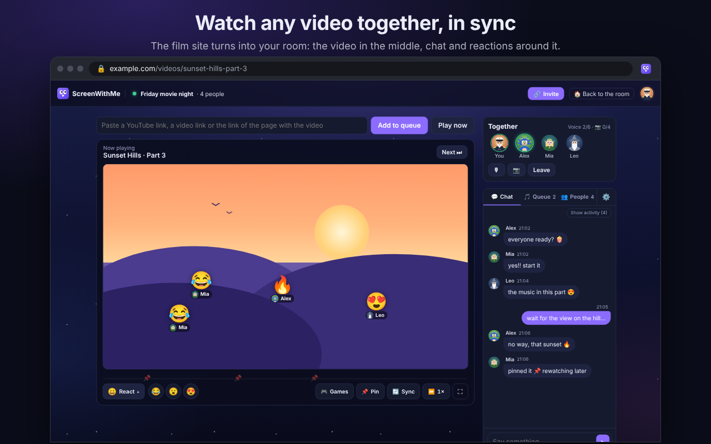
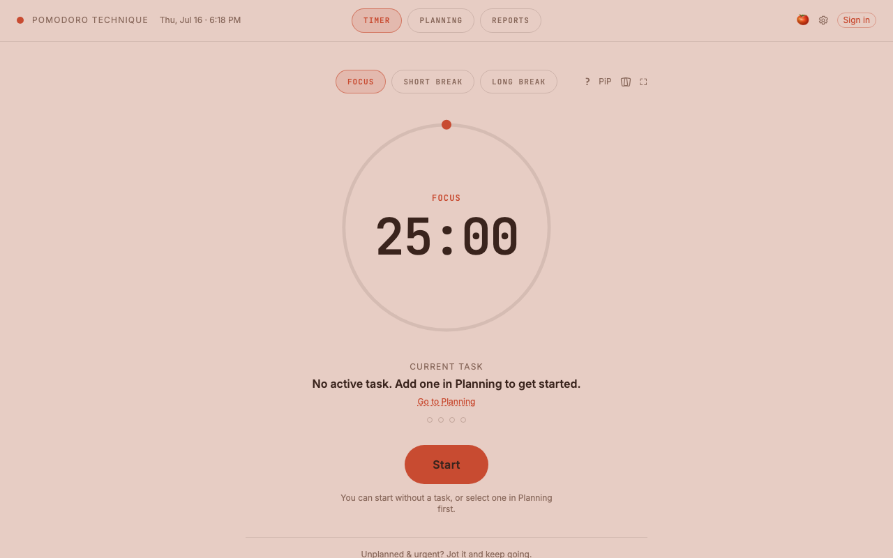

<h2 align="left">Hi 👋 I'm Alperen</h2>

4th-year Management Information Systems student at Kadir Has University (Istanbul), minoring in Digital Game Design.
I build products people actually use, and I'm focused on data science and machine learning, with software development and cybersecurity close behind.  
🔎 <b>Looking for an internship</b>: data science, ML or software development.

---

### ⭐ Featured Projects

<table>
  <tr>
    <td width="50%" valign="top">
      
      <h3>▶ ScreenWithMe</h3>
      
Watch any video together, in perfect sync. One link, no accounts: play, pause and seek happen for everyone, measured 30–100 ms apart. Chat, reactions, voice &amp; video chat, screen sharing, a shared queue and in-room games. Works on YouTube and, with the Chrome extension, on almost any site.

      
<b>TypeScript · Cloudflare Workers + Durable Objects · WebRTC · Chrome Extension (MV3)</b>

      

        🔗 <a href="https://screen-with-me.swm-server.workers.dev"><b>Live site</b></a> ·
        🧩 <a href="https://screen-with-me.swm-server.workers.dev/eklenti.html"><b>Extension</b></a>
      

    </td>
    <td width="50%" valign="top">
      
      <h3>🍅 Pomodoro Technique</h3>
      
The whole Pomodoro method, not just a 25-minute timer: task planning, estimates vs. reality, interruption logging and reports with a 13-week activity heatmap. Works offline as a guest, and syncs across devices when you sign in. Fullscreen focus mode, themes, Turkish &amp; English.

      
<b>React · Vite · Tailwind CSS · Supabase</b>

      

        🔗 <a href="https://alperenakturk.github.io/pomodoro-app/"><b>Live site</b></a>
      

    </td>
  </tr>
</table>

Source code for these projects is private for now. I'm happy to walk you through it on request.

---

### 🔬 Research

- **EV charging station location optimization**: finding where new charging stations should go *(ongoing, supervised by a research assistant at KHAS)*
- **Anomaly detection for critical infrastructure cybersecurity**: detecting attacks on industrial control systems *(KHAS)*

### 🎓 Education

- **Kadir Has University**, Management Information Systems (minor: Digital Game Design)
- **Erasmus+** exchange at Hochschule Ravensburg-Weingarten, Germany
- **Machine Learning Specialization**, Andrew Ng (Stanford / Coursera)

### 🛠️ Languages and Tools

  
  
  
  
  
  
  
  
  
  
  
  
  
  
  
  
  
  
  
  
  
  
  

### 📫 Contact

  

✉️ ahmetalperenakturk@gmail.com
